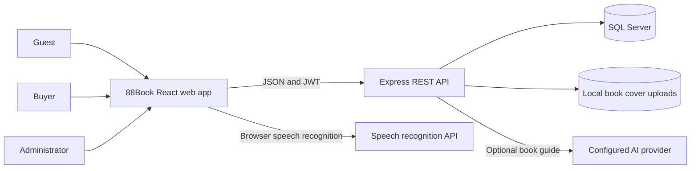
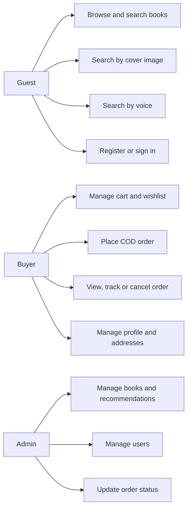
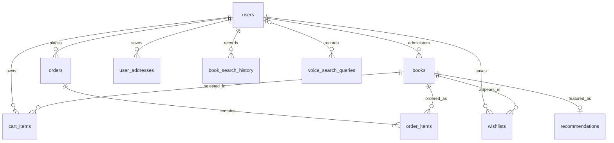
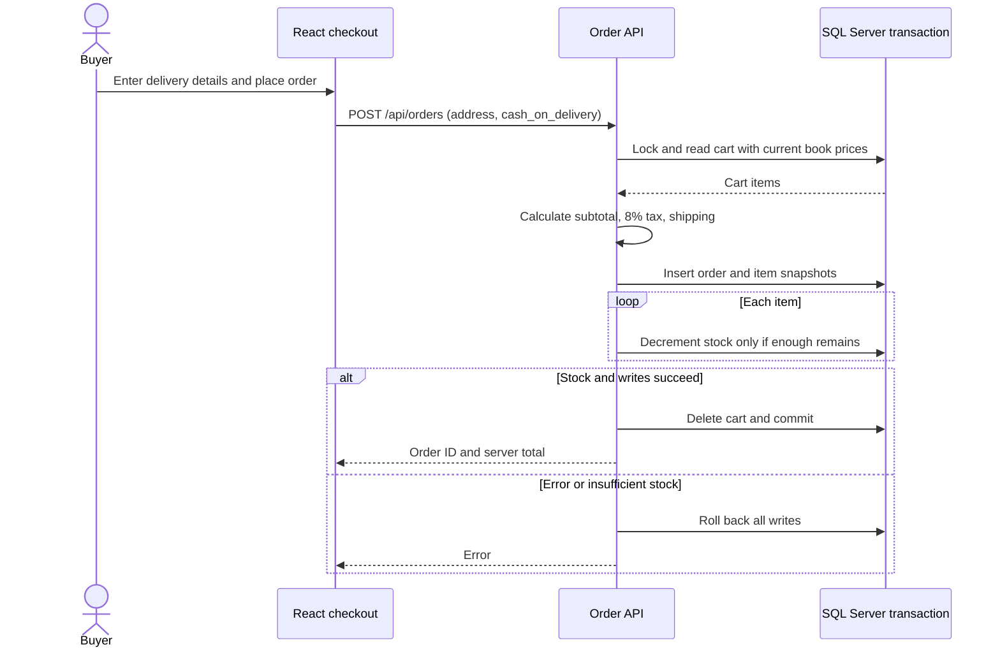
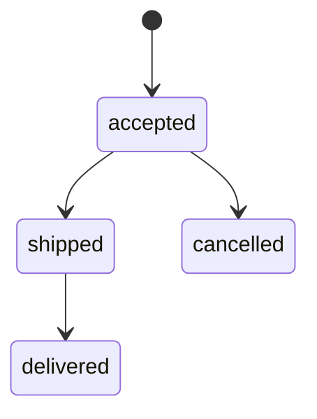

# 88Book: implemented system

This document describes the React, Express and SQL Server application in this repository. The broader diagrams in `docs/design/` are a proposed future design, not a list of implemented integrations. `88book-current-system.xmi` contains an importable UML model of the current actors, classes, methods and relationships. XMI does not preserve diagram coordinates in Visual Paradigm.

## System context

The application has no payment gateway, shipping carrier integration, payment webhooks or automated confirmation email. New orders use cash on delivery. Tracking shown by the application is based on internal order states and a separate demo view.

## Current use cases

Image search uses the implemented cover matching/OCR flow. Voice search converts speech to text and searches the catalog. Neither depends on a vector database.

## Database relationships

`orders.shipping_address` stores a snapshot of the delivery details supplied at checkout. `order_items.price` stores the book price at purchase time. The database migration adds nonnegative price/stock and positive quantity checks; it will report an error if existing rows violate them, so correct those rows before applying it.

## Checkout and cancellation

Only an accepted order can be cancelled. Cancellation and stock restoration happen in the same transaction. Admin status updates follow the same state graph.

## Pricing and runtime

- The shared `calculateOrderTotals` function is used by cart, checkout and order creation. It applies 8% tax, a 30,000 ₫ shipping fee and free shipping at 1,000,000 ₫ subtotal.
- The server calculates the saved total from database prices; it does not trust a client total.
- The checkout never asks for or stores card credentials. A real online payment option would require a payment provider and separate payment state.
- Frontend: `npm run dev` at the repository root. Backend: `npm run dev` in `backend/`. Database: `npm run migrate` in `backend/` after configuring `.env` and SQL Server.
