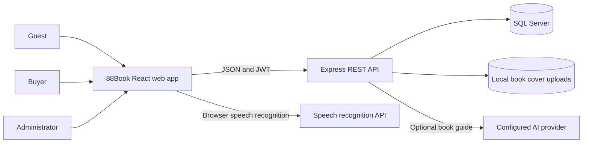
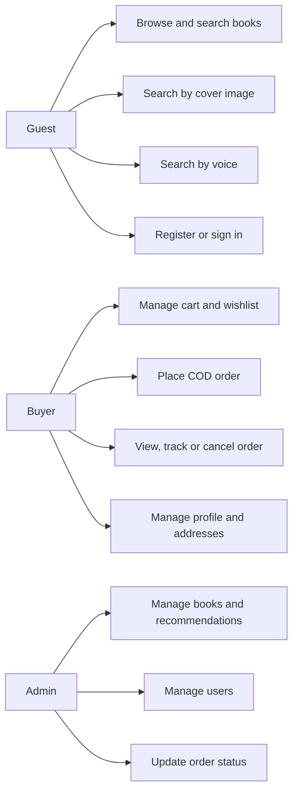
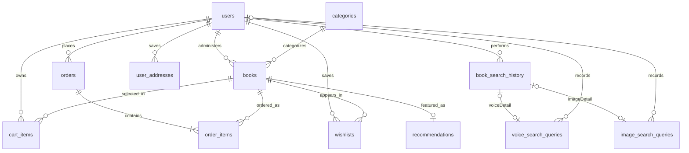
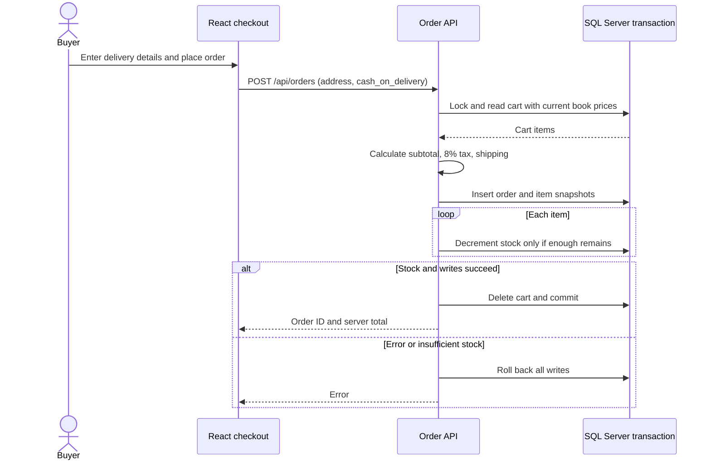
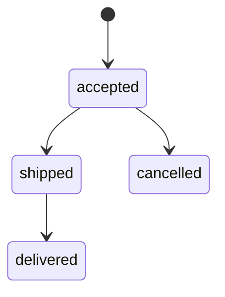

# 88Book: implemented system

This document describes the React, Express and SQL Server application in this repository. The broader diagrams in `docs/design/` are a proposed future design, not a list of implemented integrations. `88book-current-system.xmi` contains an importable UML model of the current actors, classes, methods and relationships. XMI does not preserve diagram coordinates in Visual Paradigm.

## System context

The application has no payment gateway, shipping carrier integration, payment webhooks or automated confirmation email. New orders use cash on delivery. Tracking shown by the application is based on internal order states and a separate demo view.

## Current use cases

Image search combines visual features of the marked area with OCR of the cover text. Voice search converts speech to text in the browser and then runs the same keyword search as typed queries. Neither depends on a vector database.

## Database relationships

`orders.shipping_address` stores a snapshot of the delivery details supplied at checkout. `order_items.price` stores the book price at purchase time. The database migration adds nonnegative price/stock and positive quantity checks; it will report an error if existing rows violate them, so correct those rows before applying it.

## Checkout and cancellation

Only an accepted order can be cancelled. Cancellation and stock restoration happen in the same transaction. Admin status updates follow the same state graph.

## Pricing and runtime

- The shared `calculateOrderTotals` function is used by cart, checkout and order creation. It applies 8% tax, a 30,000 ₫ shipping fee and free shipping at 1,000,000 ₫ subtotal.
- The server calculates the saved total from database prices; it does not trust a client total.
- The checkout never asks for or stores card credentials. A real online payment option would require a payment provider and separate payment state.
- Frontend: `npm run dev` at the repository root. Backend: `npm run dev` in `backend/`. Database: `npm run migrate` in `backend/` after configuring `.env` and SQL Server.

## Design model traceability (E-Commerce.vpp)

The Visual Paradigm project `E-Commerce.vpp` holds the design: a use case diagram, class diagram, ERD, component diagram, and activity and sequence diagrams for keyword, voice and image search. The table maps each design element to the code that implements it.

| Design element | Implementation |
|---|---|
| Use cases: Register account, Login | `routes/auth.js`, `AccountPage.tsx` |
| Search Product, extended by Search by Keyword / Voice / Image | `routes/search.js`, `routes/books.js` (`search-by-voice`, `search-by-image`) |
| Filter search results | Browse page: category chips (from `categories`), price range, sort |
| View Product, Add to cart, Manage cart, Place Order, View ordered products | `BookDetailsModal.tsx`, `routes/cart.js`, `routes/orders.js`, Account → Orders |
| Convert speech to text (included by Search by Voice) | Browser speech recognition in `VoiceSearchDialog.tsx` |
| Extract visual features (included by Search by Image) | `services/imageAnalysisService.js` |
| SearchController | `controllers/searchController.js` (keyword, voice, suggestions), `controllers/imageSearchController.js` (image) |
| SearchService | `services/searchService.js` (`searchByKeyword`, `searchByVoice`, `getSuggestedKeywords`) |
| ProductRepository | `repositories/productRepository.js` |
| SearchHistoryRepository | `repositories/searchHistoryRepository.js` |
| RankingService | `services/rankingService.js` (`rankByKeyword`, `rankImageResults`) |
| ImageAnalysisService / ImageService | `services/imageAnalysisService.js` (`preprocessImage`, `detectObjects`, `extractFeatures`) |
| VectorIndex | `services/vectorIndex.js` (visual features of catalog covers, cached) |
| SearchUI, TextInput, VoiceInput, ImageUpload, SearchResultView | `Navigation.tsx`, `BrowsePage.tsx`, `VoiceSearchDialog.tsx`, `ImageSearchDialog.tsx` |
| ObjectSelectionView | `ObjectSelectionView.tsx` |

### Sequence diagram steps

- **Search by keyword:** selecting the search bar loads recent searches and trending keywords (`GET /api/search/suggestions`). `validateFormat` enforces 2–50 characters ("Keyword must be 2-50 characters"). `normalizeKeyword` collapses spaces before `findByKeyword`. Submitted searches are saved with `saveSearchHistory`, and an empty result shows "No products found".
- **Search by voice:** after speech-to-text, `submitQuery(text)` calls the same `searchByKeyword`. The search is saved as a `voice` history entry with a linked `voice_search_queries` row.
- **Search by image:** the server validates the file (JPG, PNG or WebP, at most 10 MB: "Only JPG, PNG or WebP images up to 10 MB"). `extractFeatures` runs on the marked selection. `searchSimilar` combines visual similarity from `VectorIndex` with OCR text in `RankingService`. The search is saved as an `image` history entry with an `image_search_queries` row, and an empty result shows "No matching products found".

### ERD mapping

| ERD table | Database table |
|---|---|
| CUSTOMERS | `users` (with `phone`, `address`) |
| CATEGORIES | `categories`, `books.category_id` |
| PRODUCTS | `books` |
| CARTS, CART_ITEMS | `cart_items` (one cart per customer, keyed by `user_id`) |
| ORDERS, ORDER_ITEMS | `orders`, `order_items` (`price` = unit price) |
| SEARCH_HISTORIES | `book_search_history` (`search_type`: keyword, voice, image; `image_url`) |
| VOICE_SEARCH_QUERIES | `voice_search_queries` (`search_id`, `audio_path`) |
| IMAGE_SEARCH_QUERIES | `image_search_queries` (`search_id`, `image_path`, `extracted_features`) |

The schema additions are in `database/migrations/design-alignment.js` (run by `npm run migrate`) and at the end of `database/init.sql`.

### Deliberate differences from the design

- **Database engine:** the component diagram shows PostgreSQL + pgvector. The application keeps SQL Server; catalog cover features are held in an in-memory `VectorIndex`, which is enough for a catalog of this size.
- **Table names:** existing table names are kept, as mapped above, so no data migration or API change is needed. There is no separate CARTS table, because each customer has exactly one cart.
- **Stored media:** `audio_path` and `image_path` stay empty. Voice recordings and uploaded photos are not stored on the server, for privacy. Image searches store their extracted features instead.
- **Visual features:** a shape hash and a colour histogram are used instead of a neural embedding. Calibration on the catalog covers with simulated phone photos: the right cover ranks first for 27 of 27 photos with ordinary crops and lighting, and 24 of 27 for heavily degraded photos. Look-alike covers from the same series are told apart by the cover text.
- **Camera and microphone permission:** checked and requested by the browser, not by a separate PermissionManager.
